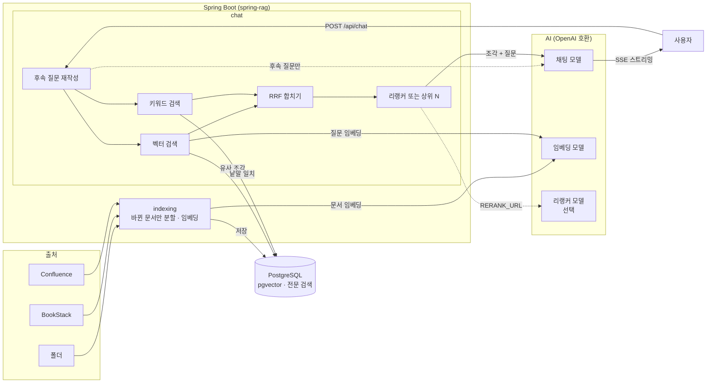

# Spring RAG

문서 기반 RAG 챗봇 템플릿. Spring Boot 4.1 · Spring AI 2.0 · PostgreSQL(pgvector).

## 실행

```bash
cp .env.example .env
docker compose up -d
./gradlew bootRun --args='--spring.profiles.active=openai'
```

```bash
curl -N localhost:8080/api/chat -H 'Content-Type: application/json' -d '{"question":"휴가 신청 방법?"}'
```

- JDK 불필요 (Gradle 이 JDK 25 다운로드)
- Docker 는 DB 용

## AI 설정

| 프로필 | 대상 | 필요한 값 |
| --- | --- | --- |
| `openai` | OpenAI API | `LLM_API_KEY` |
| `bifrost` | OpenAI 호환 게이트웨이 | `LLM_BASE_URL` · `LLM_API_KEY` · 모델 이름 |
| `ollama` | 로컬 Ollama | 없음 |

- OpenAI 호환 서버 모두 가능 (vLLM · LM Studio · LiteLLM · OpenRouter)
- 채팅 · 임베딩 서버 분리: `CHAT_BASE_URL` · `CHAT_API_KEY` / `EMBEDDING_BASE_URL` · `EMBEDDING_API_KEY`
- 임베딩 차원 변경 시: `EMBEDDING_DIMENSIONS` 수정 후 `DROP SCHEMA spring_rag CASCADE;` · 재기동
- 같은 차원의 다른 임베딩 모델로 변경 시: `POST /admin/reindex?full=true`

## 검색

| 단계 | 설정 | 기본 |
| --- | --- | --- |
| 후속 질문 재작성 | `RAG_CHAT_REWRITE` | 켬 |
| 벡터 검색 | `rag.search.vector-top-k` | 20 |
| 키워드 검색 (PostgreSQL 전문 검색) | `RAG_KEYWORD_SEARCH`, `rag.search.keyword.top-k` | 켬, 20 |
| RRF 합치기 | `rag.search.candidates` | 20 |
| 리랭커 | `RERANK_URL` | 끔 (RRF 순서 상위 `rag.chat.top-k`) |
| 프롬프트에 넣는 조각 | `rag.chat.top-k` | 5 |

- 키워드 검색: 오류 코드 · 제품 코드처럼 정확한 낱말 보완. 형태소 분석 없음 (조사 몇 개만 뗌)
- 리랭커 형식 `RERANK_API`
  - `tei`: Hugging Face TEI (`POST {RERANK_URL}/rerank`)
  - `cohere`: Cohere · Jina · vLLM 형식. `RERANK_MODEL` 필요, `RERANK_URL` 은 `/v1` 까지
- 리랭커 실패 시 RRF 순서로 답변

## 데이터

| 출처 | 켜기 | 필요한 값 |
| --- | --- | --- |
| 폴더 (기본) | `RAG_DOCS_PATH` (기본 `./docs`) | 없음 |
| BookStack | `BOOKSTACK_ENABLED=true` | `BOOKSTACK_BASE_URL` · `BOOKSTACK_TOKEN`(`id:secret`) · `BOOKSTACK_SHELVES` |
| Confluence Cloud | `CONFLUENCE_ENABLED=true` | `CONFLUENCE_BASE_URL`(`https://<회사>.atlassian.net/wiki`) · `CONFLUENCE_EMAIL` · `CONFLUENCE_TOKEN` · `CONFLUENCE_SPACES` |
| Confluence Data Center | 위 + `CONFLUENCE_DEPLOYMENT=datacenter` | `CONFLUENCE_BASE_URL` · `CONFLUENCE_TOKEN`(개인 액세스 토큰) · `CONFLUENCE_SPACES` |

- 켠 출처는 모두 함께 색인
- 폴더: md · txt · html · pdf, 하위 폴더 포함. docx · pptx · xlsx · hwp 는 `build.gradle.kts` 의 `spring-ai-tika-document-reader` 주석 해제
- Confluence: Cloud 는 REST API v2, Data Center 는 v1
- BookStack · Confluence 호출 간격 `rag.bookstack.min-interval`(기본 400ms) · `rag.confluence.min-interval`(200ms), 429 · 5xx 는 재시도
- 기타 출처 (Notion · DB 등): `DocumentSource` 구현 빈 추가
- 색인: 기동 시 (`RAG_INDEX_ON_STARTUP`), 매일 03:00 (`RAG_INDEX_CRON`, `-` 면 끔), 수동
- 수동: `curl -X POST localhost:8080/admin/reindex -H "X-Admin-Token: $RAG_ADMIN_TOKEN"`
- 바뀐 문서만 다시 임베딩, 출처에서 사라진 문서 삭제
- 출처 목록을 못 받거나 0건이면 그 출처 색인 유지

```java
@Component
class NotionSource implements DocumentSource {
    public String name() { return "notion"; }
    public List<SourceDocument> list() { /* (id, 제목, 본문) 목록 */ }
}
```

## 프롬프트

`RAG_SYSTEM_PROMPT=file:/경로/system.st` (기본 `src/main/resources/prompts/system.st`)

## API

| 경로 | 설명 |
| --- | --- |
| `POST /api/chat` | `{"question", "conversation_id"?}` → SSE `token` · `done` · `error` |
| `POST /admin/reindex` | 재색인 (`X-Admin-Token`). `?full=true` 면 전부 다시 임베딩 |
| `GET /actuator/health` | 상태 |

## 아키텍처



- 색인: 출처 → 지문 비교 → 바뀐 문서만 분할 · 임베딩 → `vector_store` (상태: `indexed_document`)
- 질문
  1. 후속 질문이면 이전 대화를 넣어 혼자 읽히는 질문으로 재작성 (채팅 모델)
  2. 벡터 검색 (질문 임베딩 → 뜻이 가까운 조각) + 키워드 검색 (낱말이 들어간 조각)
  3. RRF 로 합침 (양쪽에 나온 조각이 위로)
  4. 리랭커가 질문과 다시 비교해 상위 N, 없으면 RRF 순서 상위 N
  5. 조각 + 질문 + 이전 대화를 채팅 모델에 → 답변 스트리밍
- 대화 기록: `spring_ai_chat_memory`
- DB 스키마: `spring_rag` (Flyway)

## 구조

```text
dev.springrag
├─ model     모델 연결 (기동 로그)
├─ chat      POST /api/chat, 재작성 → 벡터 + 키워드 검색 → RRF → 리랭커 → LLM 스트리밍
├─ indexing  문서 출처 (폴더 · BookStack · Confluence) → 바뀐 문서만 색인, 예약 색인, POST /admin/reindex
└─ session   (미구현) 세션 · 검색 범위
```
