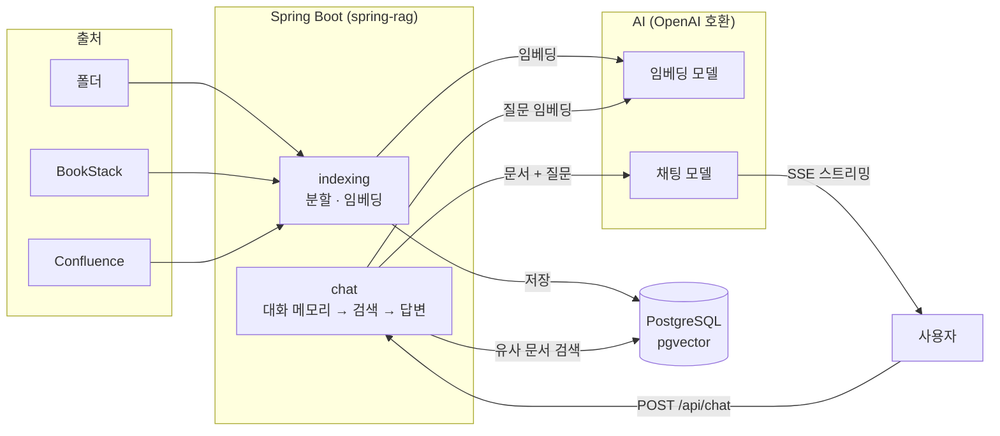

# Spring RAG

문서 기반 RAG 챗봇 템플릿. Spring Boot 4.1 · Spring AI 2.0 · PostgreSQL(pgvector).

## 실행

```bash
cp .env.example .env
docker compose up -d
./gradlew bootRun --args='--spring.profiles.active=openai'
```

```bash
curl -N localhost:8080/api/chat -H 'Content-Type: application/json' -d '{"question":"휴가 신청 방법?"}'
```

- JDK 불필요 (Gradle 이 JDK 25 다운로드)
- Docker 는 DB 용

## AI 설정

| 프로필 | 대상 | 필요한 값 |
| --- | --- | --- |
| `openai` | OpenAI API | `LLM_API_KEY` |
| `bifrost` | OpenAI 호환 게이트웨이 | `LLM_BASE_URL` · `LLM_API_KEY` · 모델 이름 |
| `ollama` | 로컬 Ollama | 없음 |

- OpenAI 호환 서버 모두 가능 (vLLM · LM Studio · LiteLLM · OpenRouter)
- 채팅 · 임베딩 서버 분리: `CHAT_BASE_URL` · `CHAT_API_KEY` / `EMBEDDING_BASE_URL` · `EMBEDDING_API_KEY`
- 임베딩 차원 변경 시: `EMBEDDING_DIMENSIONS` 수정 후 `DROP SCHEMA spring_rag CASCADE;` · 재기동

## 데이터

| 출처 | 켜기 | 필요한 값 |
| --- | --- | --- |
| 폴더 (기본) | `RAG_DOCS_PATH` (기본 `./docs`) | 없음 |
| BookStack | `BOOKSTACK_ENABLED=true` | `BOOKSTACK_BASE_URL` · `BOOKSTACK_TOKEN`(`id:secret`) · `BOOKSTACK_SHELVES` |
| Confluence Cloud | `CONFLUENCE_ENABLED=true` | `CONFLUENCE_BASE_URL`(`https://<회사>.atlassian.net/wiki`) · `CONFLUENCE_EMAIL` · `CONFLUENCE_TOKEN` · `CONFLUENCE_SPACES` |
| Confluence Data Center | 위 + `CONFLUENCE_DEPLOYMENT=datacenter` | `CONFLUENCE_BASE_URL` · `CONFLUENCE_TOKEN`(개인 액세스 토큰) · `CONFLUENCE_SPACES` |

- 켠 출처는 모두 함께 색인
- 폴더: md · txt · html · pdf, 하위 폴더 포함. docx · pptx · xlsx · hwp 는 `build.gradle.kts` 의 `spring-ai-tika-document-reader` 주석 해제
- Confluence: Cloud 는 REST API v2, Data Center 는 v1
- 기타 출처 (Notion · DB 등): `DocumentSource` 구현 빈 추가
- 색인: 기동 시 자동 (`RAG_INDEX_ON_STARTUP`)
- 재색인: `curl -X POST localhost:8080/admin/reindex -H "X-Admin-Token: $RAG_ADMIN_TOKEN"`

```java
@Component
class NotionSource implements DocumentSource {
    public List<SourceDocument> list() { /* (id, 제목, 본문) 목록 */ }
}
```

## 프롬프트

`RAG_SYSTEM_PROMPT=file:/경로/system.st` (기본 `src/main/resources/prompts/system.st`)

## API

| 경로 | 설명 |
| --- | --- |
| `POST /api/chat` | `{"question", "conversation_id"?}` → SSE `token` · `done` · `error` |
| `POST /admin/reindex` | 재색인 (`X-Admin-Token`) |
| `GET /actuator/health` | 상태 |

## 아키텍처



- 색인: 출처 → 분할 → 임베딩 → `vector_store`
- 질문: 질문 임베딩 → 유사 문서 상위 N → 문서 + 질문 + 이전 대화를 LLM 에 → 답변 스트리밍
- 대화 기록: `spring_ai_chat_memory`
- DB 스키마: `spring_rag` (Flyway)

## 구조

```text
dev.springrag
├─ model     모델 연결 (기동 로그)
├─ chat      POST /api/chat, 대화 메모리 → 벡터 검색 → LLM 스트리밍
├─ indexing  문서 출처 (폴더 · BookStack · Confluence) → 분할 → 벡터 저장소, POST /admin/reindex
└─ session   (미구현) 세션 · 검색 범위
```
